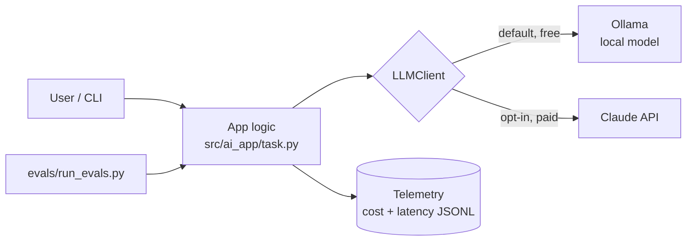

# APP NAME

> TODO: one-line pitch. What it does, for whom.


· Month N of [Monthly AI builds](https://github.com/nabil-s)

## Problem
TODO: the real-world problem in 2–4 sentences, and why a naive approach (one prompt, no evals) isn't enough.

## Architecture



TODO: replace with this app's actual components and data flow.

## Design decisions
| # | Decision | Why (one line) | ADR |
|---|---|---|---|
| 1 | Record decisions as ADRs | Make trade-offs reviewable | [0001](docs/adr/0001-record-architecture-decisions.md) |
| 2 | Local model by default, Claude opt-in | Free to run; same evals compare both | [0002](docs/adr/0002-free-first-model-backends.md) |
| 3 | Replay evals in CI, live on demand | Deterministic, free gate | [0003](docs/adr/0003-offline-replay-evals-in-ci.md) |

## Eval results
Live runs only (replay results test the pipeline, not the model). Generated by `evals/run_evals.py --mode live`.

| Model | Date | n | Metric | Score |
|---|---|---|---|---|
| TBD | TBD | TBD | TBD | TBD (not yet measured) |

## Cost per request
Measured from `.telemetry/calls.jsonl` via `uv run python -m ai_app.telemetry`. Prices: see `src/ai_app/telemetry.py`.

| Model | Mean cost / request | p50 latency | p95 latency | n |
|---|---|---|---|---|
| TBD | TBD (not yet measured) | TBD | TBD | TBD |

## Limitations
TODO: what this does not handle, known failure modes, and what you'd change for production scale.

## How to run

```bash
uv sync                                   # add --extra anthropic for the paid backend
cp .env.example .env                      # edit; never commit .env
ollama pull llama3.2:3b && ollama serve   # free local model (default provider)

uv run pytest -q                          # unit tests
uv run python evals/run_evals.py          # evals (replay, free)
uv run --env-file .env python evals/run_evals.py --mode live   # evals against your configured model
uv run python -m ai_app.telemetry         # cost + latency summary
```

## License
[MIT](LICENSE)
